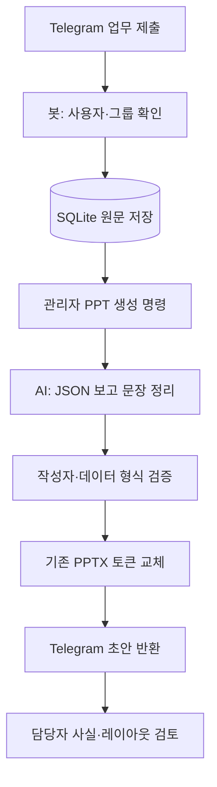

# Telegram 주간업무 PPT 봇

Ubuntu VM에서 실행하는 Python 프로젝트입니다. Telegram → SQLite → AI 내용 정리 → 기존 PPTX 양식 채우기 → Telegram 파일 반환 순서입니다.

**실제 회사 PPTX는 아직 제공되지 않았습니다.** 이 프로젝트는 토큰이 들어간 기존 양식을 채우는 기본 구현입니다. 팀원별 슬라이드 반복, 표 행 자동 추가, 분량 초과 자동 페이지 분할, 시각적 레이아웃 자동 검사는 포함하지 않습니다. 실제 양식으로 맞춤 연결할 때 해당 기능을 추가해야 합니다. 현재는 검토용 초안을 반환하며, 생성 결과의 글자 넘침과 사실관계는 사람이 확인합니다.

## 준비할 것

1. 기존 `.pptx` 양식과 작성된 보고서 예시 1개. 회사 양식에 아래 토큰을 삽입합니다.
2. Telegram BotFather에서 만든 Bot Token. 토큰은 VM의 `.env`에만 입력합니다.
3. 봇을 초대한 팀 그룹, 각 팀원의 Telegram user_id, 그룹 chat_id. `/whoami@봇이름`으로 확인합니다.
4. PPT 생성 권한을 가질 관리자 user_id와 사용자 ID → 실명 매핑.
5. AI를 쓸 때만 OpenAI API Key와 해당 계정에서 사용 가능한 Structured Outputs 지원 모델 ID.
6. 보고 주차 기준. 기본은 Asia/Seoul 월요일~일요일이며 `/submit 2026-10-19 ...`처럼 지정할 수 있습니다.

VM IP, 도메인, SSL 인증서는 봇 연결에 필요하지 않습니다. Polling 방식이므로 VM에서 `api.telegram.org:443`, `api.openai.com:443`으로 나가는 연결과 DNS가 필요합니다. Docker 이미지·패키지 설치 시 Docker Hub와 PyPI 접근도 필요합니다. 인바운드 앱 포트나 DB 포트를 열지 않습니다.

## Telegram 준비

1. Telegram에서 공식 `@BotFather`를 열고 `/newbot` 실행.
2. 봇 표시 이름과 `bot`으로 끝나는 username 설정 후 Token 발급.
3. 팀 그룹에 봇을 일반 멤버로 초대. 메시지·파일 전송이 허용되어야 합니다.
4. Privacy Mode는 기본 활성 상태로 유지해도 됩니다. `/submit@봇이름`, `/ppt@봇이름` 등 봇을 명시한 명령만 처리합니다. 단순 멘션·일반 채팅·사진·음성·파일 입력 및 과거 대화 수집은 이 버전에 없습니다.
5. 봇을 시작하고 그룹에서 `/whoami@봇이름` 전송. 각 팀원도 실행하여 user_id 확인.
6. `.env`에 허용 목록과 팀원 실명을 입력 후 컨테이너 재생성.

`/whoami`는 최초 등록을 위해 누구에게나 자신의 ID만 응답합니다. 나머지 명령은 chat_id와 user_id가 모두 허용 목록에 있어야 합니다. `/ppt`는 추가로 ADMIN_USER_IDS에 있어야 합니다. 그룹으로 제출한 내용은 그 그룹 안에서만 집계합니다. 개인 DM에서 제출하면 그룹 보고서에 합쳐지지 않으므로 하나의 팀 그룹을 사용하세요.

## Ubuntu 실행 (Docker Engine + Compose v2 설치 후)

Docker 설치는 https://docs.docker.com/engine/install/ubuntu/ 를 따르세요.

```bash
unzip weekly-report-bot.zip
cd weekly-report-bot
cp .env.example .env
chmod 600 .env
nano .env
docker compose up -d --build
docker compose logs --tail=50 bot
```

최초 `.env`에는 TELEGRAM_BOT_TOKEN만 입력하고 AI_MODE=mock을 유지해도 기동됩니다. 허용 목록이 비어 있으면 `/whoami`만 사용할 수 있습니다.

```dotenv
ALLOWED_CHAT_IDS=-1001234567890
ALLOWED_USER_IDS=111111111,222222222
ADMIN_USER_IDS=111111111
TEAM_MEMBERS_JSON={"111111111":"최찬","222222222":"팀원A"}
```

모든 ID는 위 예시가 아닌 실제 값으로 입력합니다. 허용 사용자 목록과 팀 명단을 함께 갱신하세요.

```bash
# .env 변경 후 restart만 하지 말고 재생성
docker compose up -d --force-recreate
```

한 Bot Token당 이 프로그램은 **한 인스턴스만** 실행합니다. 여러 프로세스로 실행하지 마세요. 기존 봇에서 같은 토큰을 사용했다면 기존 프로세스를 종료하세요. Webhook을 설정한 이력이 있으면 의도한 봇인지 확인한 뒤 아래 명령으로 해제합니다. 사용자 메시지를 강제 삭제하지 않습니다.

```bash
docker compose run --rm bot python -m app.manage delete-webhook
```

## 기존 PPT 양식 연결

기존 PPT를 복사해 `templates/weekly-template.pptx`로 저장합니다. 다음 토큰을 **텍스트 상자 또는 표 셀** 안에 입력하세요. 폰트·크기·위치·색은 PowerPoint에서 미리 지정합니다. 토큰 중간에 줄바꿈을 넣지 마세요. 그룹 도형 내부의 텍스트도 지원합니다.

| 토큰 | 내용 | 필수 |
|---|---|---|
| `{{TITLE}}` | 보고서 제목·초안 표시 | 선택 |
| `{{PERIOD}}` | 보고 기간 | 선택 |
| `{{MEMBERS}}` | 제출한 팀원 이름 | 선택 |
| `{{COMPLETED}}` | 팀원별 금주 실적 | 필수 |
| `{{NEXT_WEEK}}` | 팀원별 차주 계획 | 필수 |
| `{{ISSUES}}` | 팀원별 이슈 | 필수 |

예: 기존 3페이지 양식의 각 페이지 본문에 금주·차주·이슈 토큰을 넣을 수 있습니다. 원래 양식이 한 페이지 표라면 각 열 셀에 넣을 수 있습니다. **지금은 모든 팀원의 해당 항목이 한 토큰에 모여 들어갑니다.** 양식의 각 행/페이지에 특정 팀원을 배치하려면 실제 양식에 맞춰 코드를 조정해야 합니다.

텍스트 일부 run의 글꼴 스타일은 유지하지만 토큰을 구성한 여러 run의 서로 다른 스타일은 첫 run 스타일로 통합됩니다. 복잡한 SmartArt·차트·매크로·외부 링크는 보장하지 않습니다. 원본은 별도 보관하세요.

토큰 검사:

```bash
docker compose run --rm bot python -m app.manage check-template
```

실제 양식이 아직 없어도 코드 테스트는 가능합니다. 실사용 양식이 없는 상태에서 `/ppt`를 호출하면 안내 메시지로 중단합니다.

## 사용 예시

그룹에 아래 내용을 **하나의 메시지**로 전송합니다. `weekly_report_bot`은 실제 username으로 바꾸세요.

```text
/submit@weekly_report_bot 2026-10-19
[금주 업무]
- 도로공사 Studio 환경변수 설정
- LLM API 연결 확인 진행 중
[차주 계획]
- Studio 기능 테스트
[이슈]
- 외부 도메인 등록 대기
```

```text
/mine@weekly_report_bot 2026-10-19
/status@weekly_report_bot 2026-10-19
/ppt@weekly_report_bot 2026-10-19
```

날짜를 생략하면 한국시간 이번 주입니다. 같은 주차 재제출은 기존 원문 전체를 교체하며, 원본 메시지 수정 이벤트는 반영하지 않습니다. 수정할 때는 새 `/submit` 명령을 보내세요. 여러 메시지 자동 이어붙이기도 없습니다.

처음에는 AI_MODE=mock으로 테스트합니다. 이 모드에서는 제목과 캡션에 원문 테스트임을 표시하고, AI를 호출하지 않고 세 구역으로만 나눕니다.

AI 사용 전환:

```dotenv
AI_MODE=openai
OPENAI_API_KEY=실제_API_키
OPENAI_MODEL=계정에서_사용가능한_모델_ID
```

```bash
docker compose up -d --force-recreate
```

모델 API 키·사용 권한·과금 설정은 실행 계정에서 준비합니다. SDK의 Responses API와 Structured Outputs를 지원하는 모델을 사용하세요. 업무 원문이 모델 공급자에게 전달되므로 회사의 외부 AI 이용 기준에 맞춰 입력 범위를 정하세요. API의 store=False는 응답 저장 옵션이며 모든 공급자 로그·보관이 사라진다는 뜻은 아닙니다.

## 데이터와 운영

- SQLite 파일은 Docker named volume의 `/app/data/weekly.sqlite3`에 생성됩니다. DB 서버를 별도로 띄울 필요 없습니다.
- `docker compose down` 후에도 볼륨은 남습니다. `down -v`는 저장 데이터를 삭제하므로 사용에 유의하세요.
- 결과는 `/app/data/reports/<chat_id>_<update_id>/`에 원문 JSON·구조화 JSON·PPT로 보관합니다. 자동 삭제는 없으므로 운영 보관 기간을 정하세요.
- 생성 중에는 새 `/ppt` 요청을 거절하고, `/submit` 등은 처리합니다. 생성 시작 시점의 제출 내용을 스냅샷으로 사용합니다.
- API 일시 오류는 SDK가 제한적으로 재시도합니다. 앱 재시작 시 중단된 작업은 interrupted로 기록되며 새 `/ppt`로 재요청합니다. 작업 큐의 자동 복구는 없습니다.
- 같은 update_id의 `/ppt` 요청은 중복 실행하지 않습니다. 파일 전송 직후 프로세스가 종료되는 경우 전송 성공 상태를 확정할 수는 없습니다.
- 문장 사실성 검증은 작성자 ID 일치 검증과 프롬프트 규칙 수준입니다. 자동 사실 검증·시각적 넘침 검사는 구현하지 않았습니다.
- HTTP 라이브러리 로그와 예외 본문은 출력하지 않아 Bot Token·입력 원문 노출을 줄입니다.
- 미제출자가 있어도 제출자만으로 PPT를 생성합니다. 생성 전 `/status`로 확인하세요.

백업 (DB와 보고서 포함, 잠깐 중지):

```bash
docker compose stop bot
docker compose run --rm --no-deps bot python -m app.manage backup
docker compose cp bot:/app/data/backup.zip ./weekly-backup.zip
docker compose start bot
```

관리자가 데이터를 살펴볼 때는 파일을 읽거나 표준 SQLite 클라이언트를 사용하면 됩니다. 외부 DB 포트를 노출하지 마세요.

## 로컬 검증

Python 3.12 권장. 네트워크나 실제 키 없이 DB 격리·재제출·날짜·PPT 토큰 교체·API mock 구조 검증을 실행합니다.

```bash
python3 -m venv .venv
.venv/bin/pip install -r requirements.txt
.venv/bin/python -m unittest discover -s tests -v
```

실제 Telegram 송수신·AI API 호출·Docker 실행은 사용자의 VM에서 키와 양식 설정 후 검증해야 합니다.

## 전체 흐름



## 공식 참고

- Telegram BotFather: https://core.telegram.org/bots/features#botfather
- Telegram Bot API: https://core.telegram.org/bots/api
- 그룹 Privacy Mode: https://core.telegram.org/bots/faq#what-messages-will-my-bot-get
- python-telegram-bot: https://docs.python-telegram-bot.org/en/stable/
- OpenAI Structured Outputs: https://developers.openai.com/api/docs/guides/structured-outputs
- python-pptx: https://python-pptx.readthedocs.io/en/latest/
# weekly-repot
